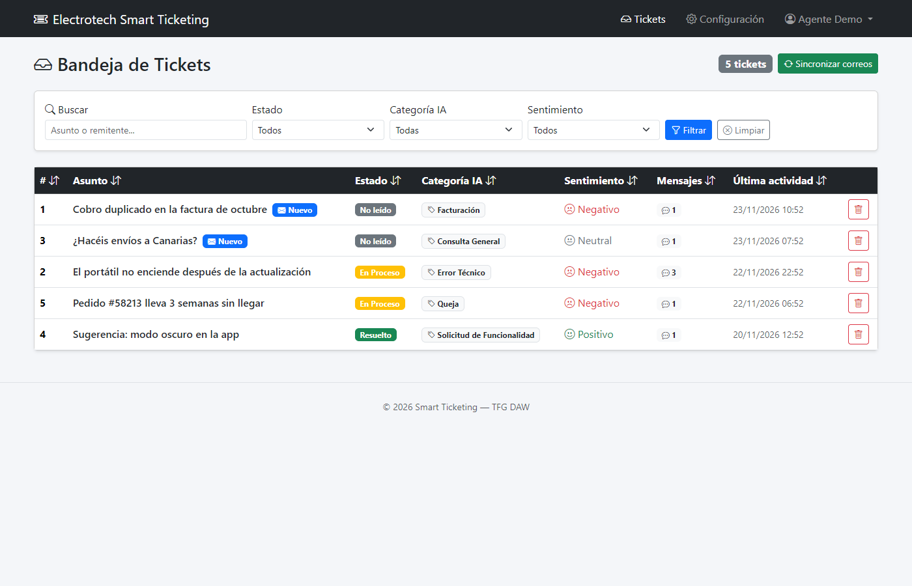
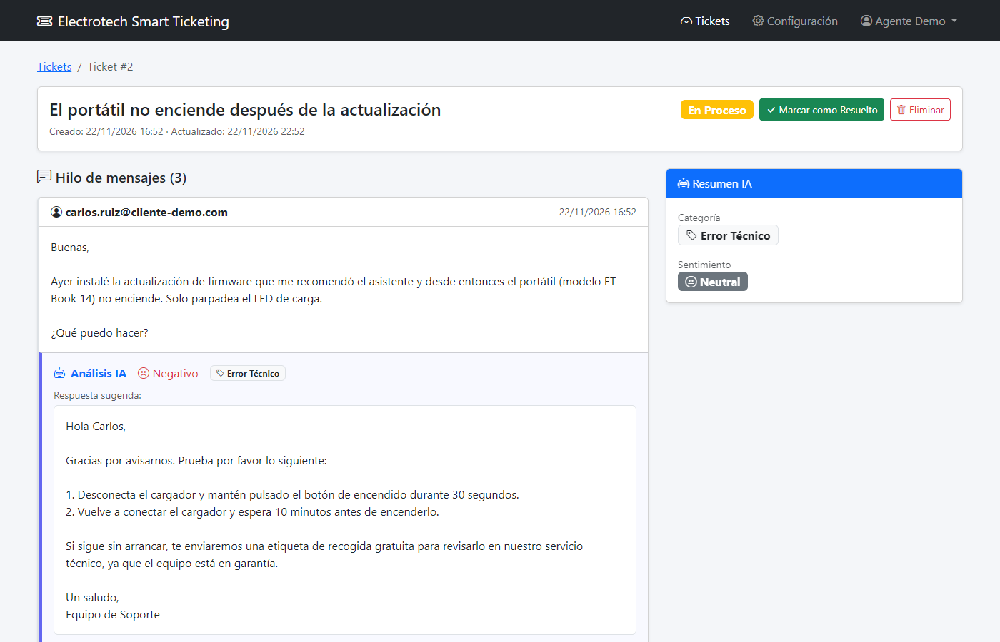
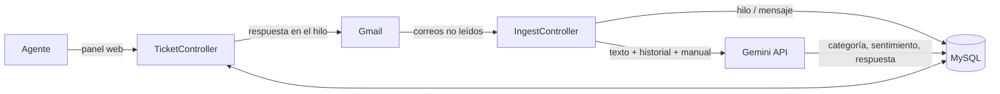

# Smart Ticketing

Sistema de soporte que convierte los correos que llegan a una bandeja de Gmail en **tickets**, y usa **IA (Google Gemini)** para clasificarlos, detectar el sentimiento del cliente y redactar una propuesta de respuesta basada en las políticas de la empresa. El agente revisa la sugerencia, la edita si hace falta y la envía sin salir del panel: la respuesta llega al cliente en el mismo hilo de correo.



## Qué resuelve

En un equipo de soporte pequeño, el correo es el canal principal y se gestiona a mano: los mensajes se pierden, no hay prioridades y cada respuesta se escribe desde cero. Smart Ticketing:

- **Agrupa conversaciones**: cada hilo de Gmail es un ticket; las respuestas del cliente se añaden al ticket existente (por `threadId` y cabecera `In-Reply-To`).
- **Clasifica automáticamente** cada mensaje en una categoría (Facturación, Error Técnico, Queja…) y detecta su sentimiento (positivo, neutral, negativo) para priorizar.
- **Sugiere respuestas fundamentadas**: la IA recibe como contexto el [manual de políticas](docs/knowledge_base.md) de la empresa (patrón RAG), de modo que plazos de devolución, garantías, etc. se citan correctamente en lugar de inventarse.
- **Responde desde el panel** vía Gmail API, manteniendo el hilo del cliente.
- **Gestiona el ciclo de vida** del ticket: No leído → En Proceso → Resuelto, con filtros, búsqueda y ordenación.



## Arquitectura



| Capa | Tecnología |
|---|---|
| Backend | PHP 8 sin framework: router, controladores, modelos y vistas propios (MVC) |
| Base de datos | MySQL 8, acceso con PDO y sentencias preparadas |
| Integraciones | Gmail API (OAuth 2.0) con `google/apiclient`, Gemini API vía cURL |
| Frontend | Vistas PHP + Bootstrap 5 |
| Entorno | Docker Compose (Apache + MySQL) |

### Estructura

```
public/index.php        Front controller y definición de rutas
src/Core/               Router, Database, Csrf, ExceptionHandler, GmailService, GeminiService
src/Controllers/        Auth, Ticket, Ingest, Settings
src/Models/             TicketModel, MessageModel, AiSuggestionModel
src/Views/              Plantillas (layout, login, tickets, ajustes, errores)
src/init.sql            Esquema de la base de datos
src/seed_demo.php       Datos de demostración
src/create_admin.php    Alta del usuario administrador
docs/knowledge_base.md  Manual de políticas usado como contexto por la IA
```

### Decisiones técnicas

- **MVC propio en lugar de un framework**, para mostrar el funcionamiento interno: enrutado con parámetros dinámicos, front controller, inyección de vistas en un layout y manejo centralizado de errores.
- **Seguridad**: contraseñas con `password_hash`, regeneración del ID de sesión al iniciar sesión, consultas preparadas contra inyección SQL, escape de toda la salida contra XSS, token CSRF en todos los formularios POST y parámetro `state` en el flujo OAuth.
- **IA con salida estructurada**: Gemini debe devolver un JSON con campos y valores cerrados; la respuesta se valida y, si falla, el ticket se crea igualmente sin sugerencia (la ingesta nunca se bloquea por la IA).
- **El agente siempre decide**: la IA propone, pero nada se envía al cliente sin revisión humana.

## Probarlo en local (5 minutos, sin Google)

Requisitos: [Docker Desktop](https://www.docker.com/products/docker-desktop/).

```bash
git clone <url-del-repo> smart-ticketing
cd smart-ticketing
cp .env.example .env                       # revisa las contraseñas de la base de datos
docker compose up -d                       # la primera vez instala dependencias (tarda un poco)
docker compose exec app php src/seed_demo.php
```

Abre <http://localhost:8080> y entra con el usuario de demo:

- **Email:** `demo@smartticketing.local`
- **Contraseña:** `demo1234`

Los datos de demo incluyen varios tickets con su conversación y el análisis IA ya generado, así que el panel se puede explorar completo sin credenciales de Google. Enviar respuestas y sincronizar correos sí requiere conectar Gmail (ver abajo).

Para parar el entorno: `docker compose down` (añade `-v` para borrar también la base de datos).

## Configuración completa (Gmail + Gemini)

1. **Gemini**: crea una API key en [Google AI Studio](https://aistudio.google.com/) y ponla en `GEMINI_API_KEY`.
2. **Gmail**: en [Google Cloud Console](https://console.cloud.google.com/):
   - Activa la **Gmail API**.
   - Configura la pantalla de consentimiento OAuth y añade tu cuenta como usuario de prueba.
   - Crea credenciales **OAuth de tipo "Aplicación web"** con la URI de redirección `http://localhost:8080/settings/callback`.
   - Copia el client ID y el secret en `GOOGLE_CLIENT_ID` y `GOOGLE_CLIENT_SECRET`.
3. **Administrador**: define `ADMIN_EMAIL` (y opcionalmente `ADMIN_PASSWORD`) en `.env` y ejecuta:
   ```bash
   docker compose exec app php src/create_admin.php
   ```
   Si no defines contraseña, se genera una aleatoria y se muestra una sola vez.
4. Inicia sesión, ve a **Ajustes → Conectar Gmail** y autoriza la cuenta.
5. Pulsa **Sincronizar** en el listado de tickets: los correos no leídos se importan y se analizan con IA.

Las políticas que usa la IA están en [`docs/knowledge_base.md`](docs/knowledge_base.md); se pueden adaptar a cualquier empresa sin tocar código.

## Autor

Hugo Vila García
